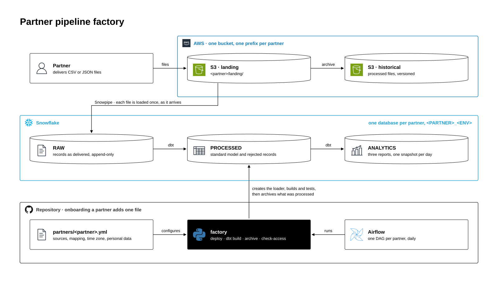

# Partner pipeline factory

A config-driven factory that onboards data partners onto Snowflake. One YAML file per partner
generates everything that partner needs: a loader (Snowpipe from S3), a processor (dbt, into a
standard model), three reports, access control and a scheduled pipeline. Onboarding a partner
is a pull request with one file, not a project.

Two sample partners are included, chosen to be different on purpose:

| Partner | Files | What makes it different |
|---|---|---|
| `MERCADOLOCAL_BR` | CSV, with and without header | Transaction unique per store, amounts written as `$1,250.00`, no customer data |
| `TIENDAVIVA_ES` | Line-delimited JSON and one JSON document | Orders re-sent when they change, amounts in cents, customer data (EU), a store in another time zone |

Only a DEV environment exists. Promotion to PROD is described in the design document.

- [Onboarding runbook](docs/onboarding-runbook.md): how to add a partner, validate it, fix
  common failures, roll back and decommission.
- [Design document](docs/design.md): decisions, trade-offs, PII, the EU note and DEV to PROD.

## How it works



Each partner gets its own database, `<PARTNER>_<ENV>` (for example `TIENDAVIVA_ES_DEV`), with
three schemas:

| Schema | Holds | Written by | Read by |
|---|---|---|---|
| `RAW` | One table per source: the record as a `VARIANT` plus source file, row number, file time, content checksum and load time. Append-only. | Snowpipe | Pipeline only |
| `PROCESSED` | `STD_STORE`, `STD_SALES_TRANSACTION` (the standard model), `REJECTED_RECORD` and the `CHECKED_*` views | dbt | Standard tables: analyst and fraud/credit. The rest: pipeline only |
| `ANALYTICS` | `RPT_BATCH_PROCESSING`, `RPT_DAILY_SALES`, `RPT_TOP_STORES` | dbt | Analyst and fraud/credit |

What is fixed in code and what a partner file decides:

- **Fixed for every partner:** the standard model (fields, types, which are required), the
  catalog of transformations, the reports, the tests, who reads what.
- **Per partner, in YAML:** sources and file patterns, where each standard field comes from,
  how the partner writes timestamps and amounts, what makes a transaction unique, time zones,
  which sources carry personal data.

A partner file cannot carry SQL. Its values are constrained by type and reach Snowflake only as
identifiers that match a strict pattern or inside string literals.

## Repository layout

```
partners/            One YAML per partner. This is what onboarding adds.
platform/dev.yml     Names of the environment: account, warehouse, roles, bucket.
src/partner_factory/ The factory: a Python package with the `factory` command.
  config.py            Schema and validation of partner and platform files.
  standard_model.py    The standard model. Changing it changes the contract for every partner.
  sql.py, templates/   Generated SQL: platform bootstrap and per-partner loader.
  processor.py         Compiles a partner mapping into the variables dbt runs with.
  archive.py           File states, and the move from landing to historical.
  drift.py             Compares deployed pipes and file formats with the configuration.
  access.py            Who reads what, and the check that proves it.
  cli.py               The commands.
dbt/                 One generic dbt project, run once per partner.
infra/aws/           Terraform: bucket, IAM role for Snowflake, bucket notification.
airflow/             Astro project. One DAG per partner, generated from partners/.
sample_data/         Fictional files for the two partners, and the script that writes them.
tests/               pytest: configuration, generated SQL, archive, drift, access.
docs/                Runbook and design document.
```

## Requirements

- Python 3.12 or 3.13 and [uv](https://docs.astral.sh/uv/).
- A Snowflake account on Enterprise Edition or higher (tags and masking policies), with
  `ACCOUNTADMIN` for the one-time bootstrap.
- An AWS account, the AWS CLI v2 and Terraform 1.9 or later.
- OpenSSL, to create the key pair of the service user.
- Docker and the Astro CLI, only to run Airflow locally.

```bash
uv sync --extra dev --locked
```

Every command below is run from the repository root.

## Setting up an environment

Done once per environment. The order matters because Snowflake and AWS each need a value that
only exists after the other side has been created, so Terraform is applied twice.

**1. Key pair of the service user.** Keep both files outside the repository.

```bash
openssl genrsa 2048 | openssl pkcs8 -topk8 -inform PEM -nocrypt -out svc_rsa_key.p8
openssl rsa -in svc_rsa_key.p8 -pubout -out svc_rsa_key.pub
```

**2. Bootstrap, as an account administrator.** The only step that needs one. It creates the
pipeline role, the service user, the two reader roles, the warehouse (XS) and the storage
integration. Everything after this is done by the service user.

```bash
SNOWFLAKE_USER=<admin user> SNOWFLAKE_ROLE=ACCOUNTADMIN \
SNOWFLAKE_PRIVATE_KEY_FILE=/path/to/admin_rsa_key.p8 \
  uv run factory platform bootstrap --service-public-key /path/to/svc_rsa_key.pub
```

From here on, the only credential the factory needs is the private key of the service user:

```bash
export SNOWFLAKE_PRIVATE_KEY_FILE=/path/to/svc_rsa_key.p8
```

**3. Terraform, first apply.** Creates the bucket and the role Snowflake assumes. The role
trusts the storage integration created in step 2, so the factory first writes what Terraform
needs from Snowflake to `infra/aws/snowflake.auto.tfvars.json` (ignored by git).

```bash
uv run factory platform aws-vars
AWS_PROFILE=<profile> terraform -chdir=infra/aws init
AWS_PROFILE=<profile> terraform -chdir=infra/aws apply
```

**4. Deploy the first partner.** Creating a pipe makes Snowflake assume the AWS role, which is
why step 3 comes first.

```bash
uv run factory deploy MERCADOLOCAL_BR
```

**5. Terraform, second apply.** The bucket notification that feeds Snowpipe points at a queue
that Snowflake only creates with the first pipe.

```bash
uv run factory platform aws-vars
AWS_PROFILE=<profile> terraform -chdir=infra/aws apply
```

There is one notification for the whole bucket and one queue per account, so later partners
need no Terraform at all: `factory deploy <PARTNER>` is enough.

The Terraform state is a local file, ignored by git.

## Day-to-day commands

| Command | What it does |
|---|---|
| `uv run factory validate` | Checks the platform file and every partner file. Needs no connection. |
| `uv run factory deploy <PARTNER>` | Creates what is missing: database, schemas, stages, raw tables, pipes, tag, masking policy, reader grants. Never replaces anything. Stops with the procedure to follow if a deployed pipe or file format differs from the configuration. `--dry-run` prints the SQL. |
| `uv run factory load-status <PARTNER>` | State of each pipe, records loaded per file, and the state of every file still in landing. |
| `uv run factory dbt <PARTNER> build` | Builds the standard model and the reports and runs the tests. Any dbt command and option can follow the partner code. |
| `uv run factory archive <PARTNER>` | The daily run: lists the completely loaded files, runs `dbt build`, and only if it passes moves those files from `landing/` to `historical/`. Exits with an error if the build fails or a listed file could not be moved. |
| `uv run factory check-access <PARTNER>` | Opens one session per role and shows what it can read and whether it sees customer references. Exits with an error if anything differs from the rules. |
| `uv run factory dbt-vars <PARTNER>` | Prints what the partner file compiles to. Useful in review. |

Things worth knowing before running them:

- **A file name is loaded once.** Snowpipe does not load a name it has already loaded, even
  when the content changes. A correction has to arrive under a new name.
- **`--lookback-hours`** (on `dbt` and `archive`) sets how far back from the newest processed
  record the incremental model reads again. The default is 24.
- **`--full-refresh` also rebuilds the reports**, and a rebuilt report only has the snapshot of
  the day: snapshots of earlier days are lost. Nothing prevents it today.
- **Report snapshots are dated in the partner's time zone**, so the same run can be dated a day
  apart for two partners.
- **`.env` is not read by the factory.** `.env.example` lists the variables; export them.

## Tests and CI

```bash
uv run ruff check .
uv run ruff format --check .
uv run factory validate
uv run pytest
```

| Suite | Size | Needs |
|---|---|---|
| `uv run pytest` | 136 cases | Nothing: configuration in, text out |
| `uv run factory dbt <PARTNER> test` | 55 per partner: 50 data tests and 5 unit tests | Snowflake |
| `uv run pytest -m integration` | 1 case | Snowflake. Runs dbt against DEV on two past snapshot dates and removes them. Left out of the default run and of CI. |
| DAG import test | 3 cases | Nothing |

With the sample data, 54 dbt tests pass and 1 warns in each partner: a sale whose store is not
in the partner's store list. It is a warning by design, because the partner can list the store
the day after.

CI (`.github/workflows/ci.yml`) runs on every pull request and on `main`: lint, `factory
validate`, pytest, and the DAG import test with the same Airflow version. CI has no Snowflake
credentials, so it does not run dbt or the pipeline.

## Airflow

`airflow/dags/partner_pipelines.py` generates one DAG per file in `partners/`, named
`partner_<partner>`, scheduled daily at 06:00 UTC. Each DAG has two tasks, both plain `factory`
commands: `deploy`, then `process_and_archive`. Airflow holds no pipeline logic.

```bash
cd airflow
FACTORY_SNOWFLAKE_KEY=/absolute/path/to/svc_rsa_key.p8 astro dev start
astro dev run dags unpause partner_mercadolocal_br
astro dev run dags list-runs partner_mercadolocal_br
astro dev stop
```

The UI is at http://localhost:18280. DAGs start paused. More in
[airflow/README.md](airflow/README.md).

A full scheduled run of both DAGs was done on this local Airflow. CI only proves the DAGs
import and have the expected shape.

## Sample data

[sample_data/README.md](sample_data/README.md) lists every file, what each one exercises and
how to deliver them. Measured in DEV with all of them loaded:

| | Records | Valid | Rejected | Transactions | Stores |
|---|---|---|---|---|---|
| `MERCADOLOCAL_BR` | 140 | 125 | 15 | 101 | 8 |
| `TIENDAVIVA_ES` | 63 | 60 | 3 | 49 | 6 |
