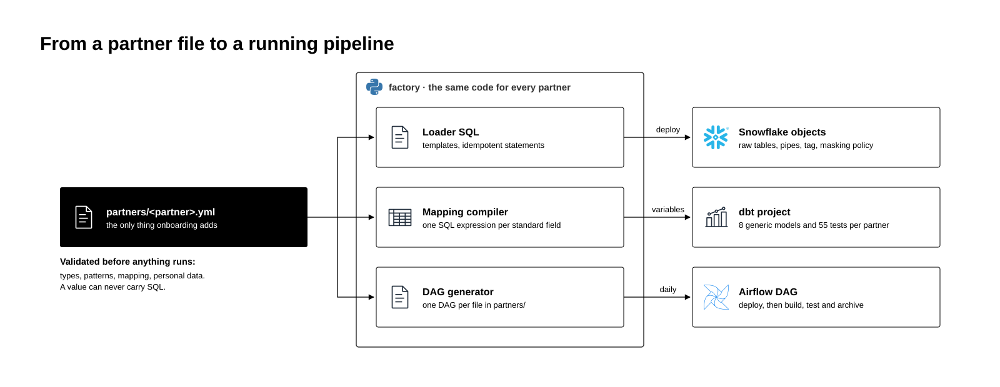
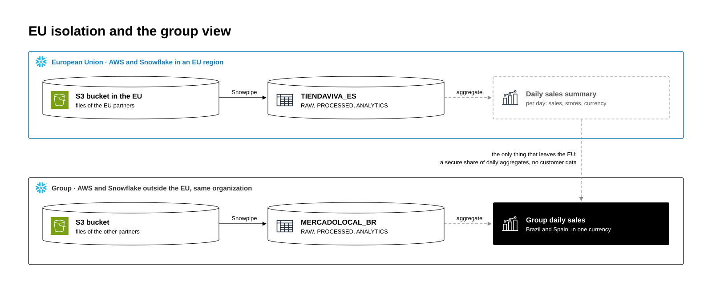

# Design

How the factory is built and why. Running it is in the [README](../README.md); onboarding a
partner, in the [runbook](onboarding-runbook.md). Figures were measured in DEV; what was not
built or not tested is said as such.

## 1. From a partner file to a running pipeline



A partner is one file, `partners/<partner>.yml`. The `factory` command reads it and produces
three things; nothing per partner is written by hand.

- **Loader.** Sources, file patterns and CSV layout go through SQL templates, run by
  `factory deploy`: database `<PARTNER>_<ENV>` with `RAW`, `PROCESSED` and `ANALYTICS`; per
  source a raw table and an auto-ingest pipe; pseudonymization key, `PII` tag, masking policy,
  reader grants.
- **Processor and reports.** A compiler turns the mapping into one SQL expression per standard
  field, passed as variables to one generic dbt project: 8 models and 55 tests per partner.
- **Orchestration.** A generator gives each file a DAG, `partner_<partner>`: `factory deploy`,
  then `factory archive` (build, test, move the processed files to `historical/`).

`factory validate` runs first, with no connection: a typo, an unmapped required field or an
identifier that is not pseudonymized fails in CI, before anything reaches Snowflake.

Choices: **Airflow**, because R2 runs it; it holds no logic, both tasks are `factory` commands.
**dbt Core driven by the factory**, one entry point for laptop, CI and Airflow. I did not
evaluate dbt Projects on Snowflake, so this is a deviation from the stated preference, not a
conclusion against it. **One database per partner**: grants and removal are per database.
Not built: the bonus loader that proposes a mapping, and partner write access to its prefix.

## 2. Configuration, and where it stops

The partner file says **where a value comes from and how the partner writes it**, never what
it becomes.

| In the partner file | In code, the same for every partner |
|---|---|
| Sources, file patterns, batch date in the name, CSV layout | The standard model: fields, types, which are required |
| Which raw field feeds each standard field | The catalog of transformations (`lower`, `upper`, `remove_spaces`, `pseudonymize`) |
| Timestamp format, amount notation, status map | Validation, deduplication, rejection, time zones, reports, tests |
| Transaction key, time zone, per-store exceptions, personal-data flag | Who reads what, tagging and masking |

- **No SQL in configuration.** A transformation outside the catalog is a code change. It costs
  flexibility and buys that reviewing a YAML is enough to approve a partner. Values are typed
  and reach Snowflake only as strict identifiers or inside literals escaped in one place.
- **Declared, not guessed.** `63,98` is 63.98 in one notation and 6,398 in another. The
  notation is declared and a value outside it is rejected, not cleaned.

## 3. Data model

The source tables in `RAW` are append-only and written only by Snowpipe: one per source, the
same shape for CSV and JSON. Nothing is typed at load, so a bad row never blocks a file.

```sql
CREATE TABLE <PARTNER>_<ENV>.RAW.<SOURCE> (
    RECORD VARIANT,                         -- one delivered record, untyped
    SOURCE_FILE VARCHAR, FILE_ROW_NUMBER NUMBER(38, 0),
    FILE_LAST_MODIFIED TIMESTAMP_NTZ,       -- when the partner delivered the file (UTC)
    FILE_CONTENT_KEY VARCHAR,               -- checksum, to tell re-sent files apart
    LOADED_AT TIMESTAMP_LTZ
);

CREATE TABLE <PARTNER>_<ENV>.PROCESSED.STD_STORE (
    PARTNER_CODE VARCHAR, STORE_ID VARCHAR, STORE_NAME VARCHAR, COUNTRY_CODE VARCHAR(2),
    IS_ACTIVE BOOLEAN, FIRST_SEEN_AT DATE, LAST_SEEN_AT DATE
);

CREATE TABLE <PARTNER>_<ENV>.PROCESSED.STD_SALES_TRANSACTION (
    PARTNER_CODE VARCHAR, TRANSACTION_ID VARCHAR, STORE_ID VARCHAR,
    TRANSACTION_TS_UTC TIMESTAMP_NTZ, TRANSACTION_DATE_LOCAL DATE,
    AMOUNT NUMBER(11, 2), CURRENCY_CODE VARCHAR,
    STATUS VARCHAR,                         -- COMPLETED, REFUNDED, PENDING, CANCELLED
    CUSTOMER_REF VARCHAR(128),              -- keyed SHA-256; masking policy and PII tag
    BATCH_DATE DATE, SOURCE_FILE VARCHAR, LOADED_AT TIMESTAMP_NTZ,
    SOURCE_ROW_NUMBER NUMBER(38, 0),        -- added: with SOURCE_FILE, points at RAW
    SOURCE_FILE_MODIFIED_AT TIMESTAMP_NTZ,  -- added: first criterion of "last received"
    SOURCE_UPDATED_AT_UTC TIMESTAMP_NTZ     -- added: version time, when the partner sends one
);
```

The standard tables are built by dbt; this is their resulting shape for TiendaViva
(`CUSTOMER_REF` is `VARCHAR` with no length where the partner sends no customers).
`REJECTED_RECORD` holds entity, source file, row number, batch date and an array of reasons.
`ANALYTICS` holds the three reports, each keyed by `SNAPSHOT_DATE`: one snapshot per day.

Changes to the draft model: the **transaction key is declared per partner** (MercadoLocal's
ids are unique per store); **three columns were added** so every row traces to its raw record
and the current version is testable; **rejected records are not copied**, they point at RAW,
so raw personal data stays in one schema.

## 4. Behaviour

**Deduplication.** One row per key. The current record is the latest version the partner
declares (`updated_at`), otherwise the last received: file time in the bucket, file name, row.
A late file with an older version does not replace a newer one. A superseded record still
counts as valid: raw equals valid plus rejected, asserted by a test.

**Idempotency.**

- `deploy` only creates what is missing. It never replaces a pipe, which would drop its load
  history; if a deployed source differs from the configuration it stops with the procedure.
- Snowpipe loads a file name once. Measured: the same name with other content is ignored; a
  correction needs a new name.
- The sales model is an incremental merge on the key. A test recomputes it from RAW and
  compares every column. A report run replaces the snapshot of its date, also when empty.
  Limit: `--full-refresh` rebuilds the reports and keeps only the snapshot of the day.
- Archiving copies to `historical/`, confirms the checksum and only then removes from
  `landing/`; a retry skips what was moved.

**Rejected rows.** Every conversion is a `TRY_` or guarded expression: a bad value gives a
reason (`missing_<field>`, `invalid_<field>`), never a failed run. Measured: 15 of 140 records
rejected for MercadoLocal and 3 of 63 for TiendaViva, all planted in the sample data. Nothing
deletes records from RAW or alerts on the share of rejected records.

**Time zones.** Local times are converted to UTC with the partner's zone, with per-store
exceptions: 15:05 in TiendaViva's Canary Islands store is stored as 14:05 UTC. Reports group
by the local date. Sessions run in UTC, asserted by a test.

**Schema changes.** A new JSON field lands in RAW untouched and is ignored until mapped. A CSV
line with a field too many is rejected. Only the first surplus position is read: a line whose
first surplus field is empty and a later one is not passes and loses that content. A changed
layout of a deployed source stops `deploy`. A change to the standard model is a code change.
Not tested: a malformed JSON line; I do not claim what the pipe does with it.

## 5. PII

- **Pseudonymization.** The only customer field that leaves RAW is `customer_ref`: SHA-256 of
  the identifier with a key generated inside Snowflake, one per partner, so customers are
  unlinkable across partners. Email and phone are never mapped. Validation rejects an
  identifier that is not pseudonymized.
- **Tagging.** Tag `PII`: `CUSTOMER_DATA` on the raw record of sources declared
  `personal_data: true`, `PSEUDONYMIZATION_KEY` on the key table, `PSEUDONYM` on `customer_ref`.
- **Masking and access.** Policy `CUSTOMER_REF_MASK` shows the value to the pipeline and to
  fraud/credit, and `NULL` to everyone else. Two reader roles, analyst and fraud/credit, read
  the standard tables and the reports. RAW, the validation views, the rejected records and the
  key stay with the pipeline.

A rebuilt table loses policy, tag and grants; dbt restores them in the same run, policy before
grants, and a test fails the build if one is missing. `factory check-access` opens a session
per role. Measured for TiendaViva: pipeline and fraud/credit see 48 of 49 references, the
analyst 0 of 49.

Limits: changing who sees `customer_ref` is a manual `ALTER MASKING POLICY`; reader roles are
per environment, not per partner; tags and masking need Snowflake Enterprise Edition.

## 6. EU data and the group view



Not implemented; this is how I would do it. TiendaViva's data stays in the EU end to end: a
bucket and a Snowflake account in an EU region, in the same organization as the group account.
The factory does not change: an environment is a file naming an account and a bucket, so the EU
is one more `platform/<env>.yml`. Every reader of customer-level data is in the EU account.

The group summary is built from aggregates, not rows. The EU account keeps one table of daily
sales per partner (date, sales, total, stores, currency) in a database of its own, with no
customer reference and no transaction row, and shares it with the group account. Sharing across
regions replicates data, and only that database is replicated. The group account joins it with
the same aggregate of its own partners and an exchange-rate table. To settle with R2 first:
which exchange rate finance uses.

## 7. From DEV to PROD

Only DEV exists. The CLI takes `--env`, so PROD is another platform file with its own account,
bucket, roles and key. **Roles:** nobody holds the PROD pipeline role interactively.
**Approvals:** a partner reaches PROD by pull request, with CI, a reviewer and the runbook's
go-live checklist. **Data:** DEV uses fictional and partner-provided test files, never
production personal data.

| Component | Today | In PROD |
|---|---|---|
| Airflow | Astro CLI in Docker, on a laptop | Managed Airflow; the same DAG file |
| A partner's first deploy | Run by hand | Run by CI on merge to `main`, with `--env prod` |
| Environment | Only `platform/dev.yml` | A `platform/prod.yml`, another account and bucket |
| Terraform state | Local file, outside git | A separate S3 bucket, versioned and locked |
| Service user key | A local file | A secrets manager |
| AWS access | A user session | A role assumed from GitHub with OIDC |
| File delivery | Uploaded by hand, standing in for the partner | The partner writes to its `landing/` prefix |

## 8. Questions and assumptions

Questions still to ask R2, each with the assumption the code runs on.

| Question | Assumption |
|---|---|
| The sales sample has a `source_id` the column table omits. Which is right? | Seven columns, as in the sample |
| Amounts come as `$63.98`. Is that Brazilian real? | BRL, from the partner file |
| Can a file be re-sent under the same name? | It happens; a correction needs a new name |
| Is `06/10/2026` 6 October? Do stores of a partner span time zones? | `DD/MM/YYYY`; one zone per partner, per-store exceptions |
| Does a refunded or pending order count as a sale? | Only `COMPLETED` counts |
| Is a transaction id unique across the partner? Is a duplicate valid in report 1? | Declared per partner; valid: raw = valid + rejected |
| MercadoLocal sends no status. Is a sale of an unlisted store valid? | `COMPLETED`; yes, the test only warns |
| Does report 1 count every source? What is its processing date? | Every source; UTC date of the batch's last load |
| Does fraud/credit need the person or only to link purchases? | Only link: the pseudonym, never the identifier |

## 9. AI assistants

**Workflow.** Three roles, kept apart. One agent (Claude Code) wrote the code and ran it
against the real accounts. A second agent reviewed each change. A third pass checked every
claim of a progress report against GitHub, Snowflake and S3 before accepting it. I decided
scope, stack and trade-offs and approved each merge. The rule that did most of the work: the
builder's own report is not evidence.

**Where they were wrong.**

- **SQL injection:** the first templates put free text from the configuration into SQL
  comments. The first review missed it; the second found it.
- **Data lost while counts matched:** CSV lines with a field too many lost that field.
- **Wrong values:** cleaning stripped separators, so `63,98` became 6,398.00; and one zone per
  partner left the Canary Islands store an hour off.
- **Archiving:** two bugs stopped by the confirm-before-remove step before any file was
  deleted; later, an exit code of 0 on failure and an empty run that kept the old snapshot.
- **A wrong assumption:** that a file re-sent under the same name would be reloaded.
- **Inflated reports:** 31 tests reported when there were 27, and 61 when there were 54.
